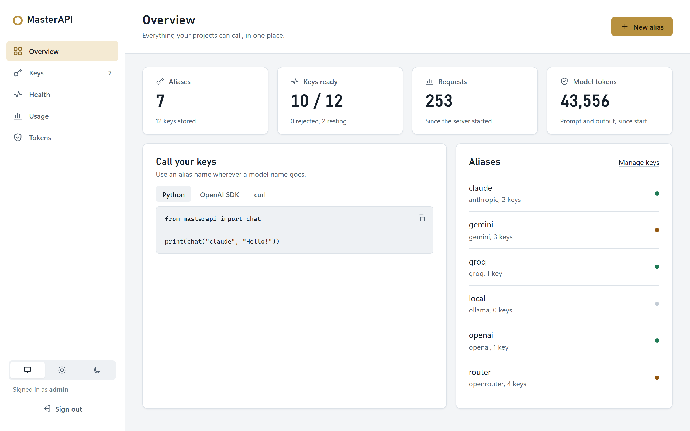
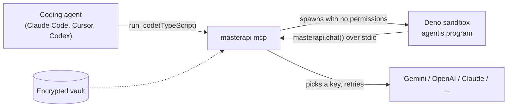
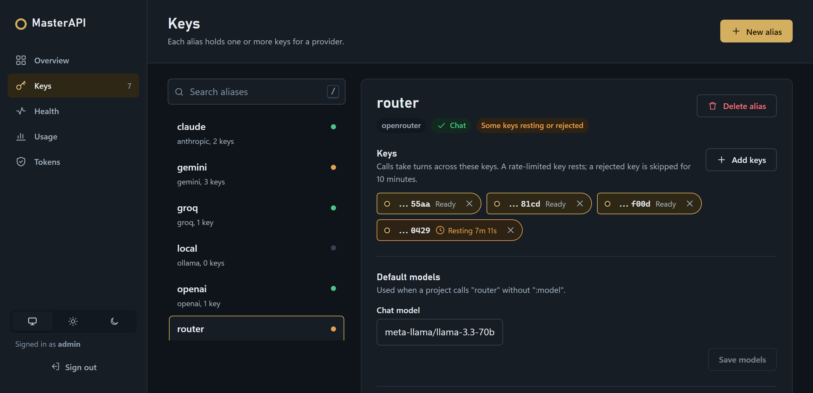
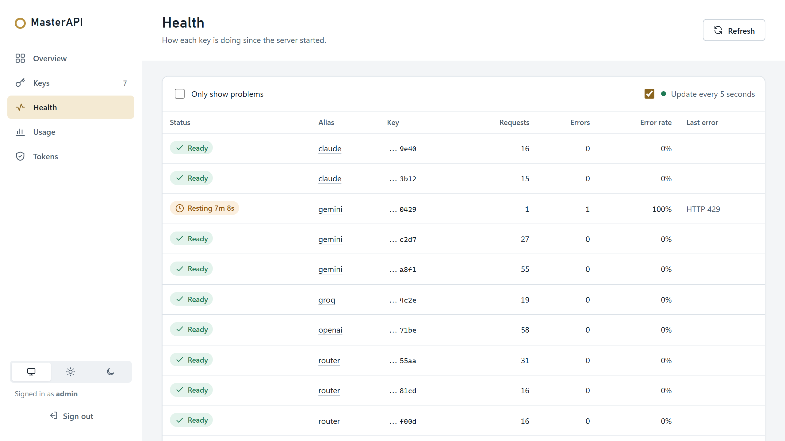
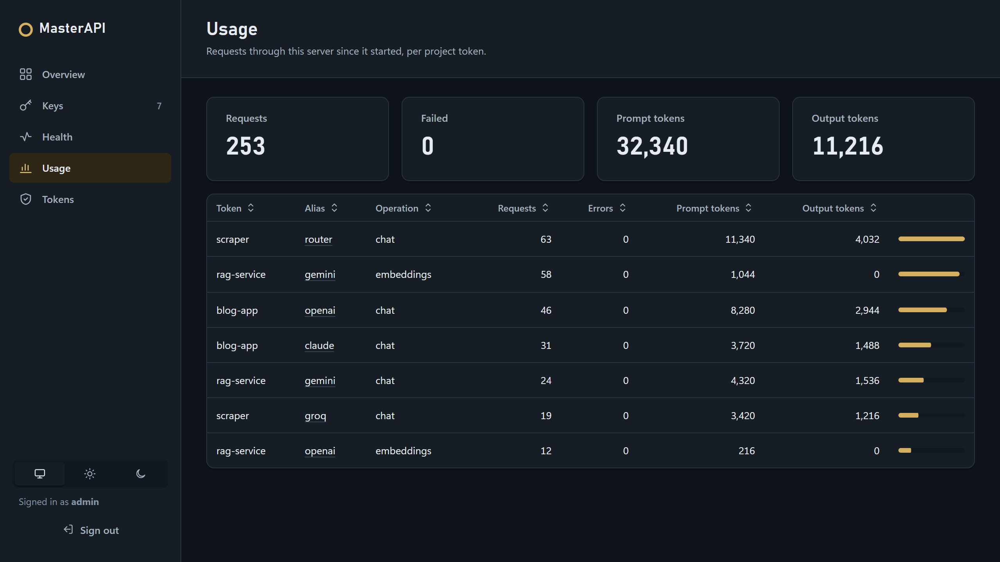
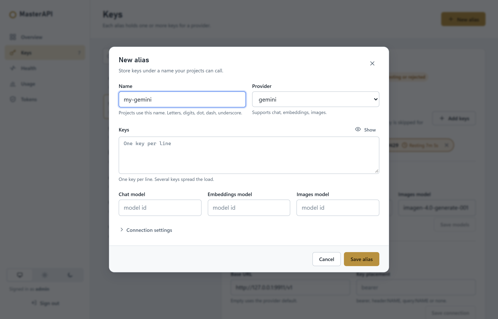
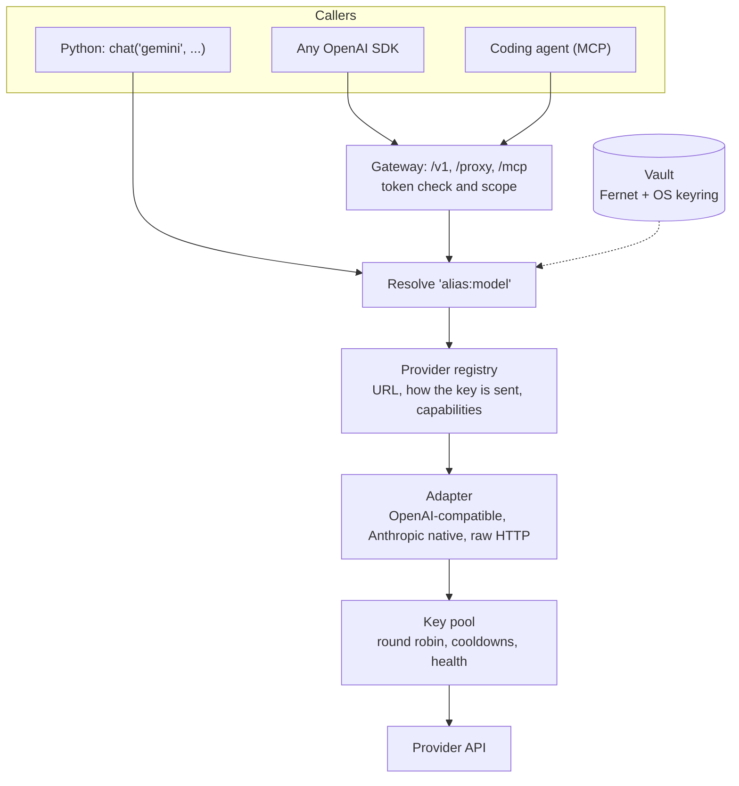

<div align="center">

# MasterAPI

**One home for all your AI API keys. Call any model by name, from any project.**

Store your OpenAI, Gemini, Claude, OpenRouter, Groq and other keys once, give them
names, and use `chat("gemini", "hi")` everywhere. Bulk keys rotate on their own,
projects never see a key, and your coding agents get every model through MCP.

[](https://github.com/Prateekiiitg56/MasterAPi/actions/workflows/ci.yml)
[](https://www.python.org/)
[](#for-coding-agents-mcp--code-mode)
[](LICENSE)

[Install](#install) · [Use it](#use-it) · [Coding agents](#for-coding-agents-mcp--code-mode) · [Dashboard](#dashboard) · [Setup guide](docs/SETUP.md) · [Security](SECURITY.md)



</div>

## Why

Every project ends up with its own `.env` full of the same API keys. Free-tier keys
hit rate limits. Switching from GPT to Gemini means new SDKs and new code. Coding
agents can't use your other models unless you paste keys into their config.

MasterAPI fixes that with one small, self-hosted tool:

| | |
|---|---|
| 🔐 **Keys in one encrypted vault** | Encrypted on disk; the unlock key lives in Windows Credential Manager, macOS Keychain or Secret Service. |
| 🏷️ **Call by name** | `chat("gemini", ...)`, `embed("openai", ...)`, `image("openai", ...)`. Pick a model per call with `"router:meta-llama/llama-3.3-70b-instruct:free"`. |
| 🔁 **Bulk keys that rotate** | Put ten free-tier keys under one name. Calls take turns; a rate-limited key rests for its `Retry-After`, a rejected key sits out 10 minutes. |
| 🌐 **One format for every provider** | OpenAI's request format works everywhere. Claude's native API is translated, including tools, images and streaming. |
| 🧩 **Any API with a key** | ElevenLabs, Replicate, Deepgram or your own service, through a passthrough that adds the key. |
| 🤖 **Built for coding agents** | An MCP server for Claude Code, Cursor, Codex and more, with **Code Mode**: agents write TypeScript that runs in a locked-down Deno sandbox. |
| 🎟️ **Per-project tokens** | Each project gets its own revocable token, optionally limited to some names. |
| 📊 **Dashboard** | Add keys, watch key health and usage, manage tokens. Light and dark, works on a phone. |

## Install

One line. It installs [uv](https://docs.astral.sh/uv/) if needed, MasterAPI and
[Deno](https://deno.com) (the Code Mode sandbox), then runs a short setup that stores
your first key and connects your coding agents.

**Windows (PowerShell)**

```powershell
irm https://raw.githubusercontent.com/Prateekiiitg56/MasterAPi/main/install.ps1 | iex
```

**macOS / Linux**

```bash
curl -fsSL https://raw.githubusercontent.com/Prateekiiitg56/MasterAPi/main/install.sh | sh
```

<details>
<summary>Other ways: uv, pip, from source, Docker</summary>

```bash
uv tool install git+https://github.com/Prateekiiitg56/MasterAPi && masterapi setup
pip install git+https://github.com/Prateekiiitg56/MasterAPi && masterapi setup
```

From source: `git clone https://github.com/Prateekiiitg56/MasterAPi && cd MasterAPi && pip install -e .`

Docker and running it as a background service are covered in the [setup guide](docs/SETUP.md).
</details>

Setup takes about a minute:

```text
$ masterapi setup
Vault:     C:\Users\you\.masterapi\vault.enc (0 aliases)
Code Mode: ready (Deno found)

Add an API key now? [Y/n]
Provider [gemini]: gemini
Name your projects will use [gemini]:
Default chat model [gemini-2.5-flash]:
API key (blank to finish): ****
API key (blank to finish):
  saved 'gemini' with 1 key(s)
Send a test message through 'gemini'? [Y/n]
  reply: Hi there, how are you?

Connect MasterAPI to Claude Code, Codex, Claude Desktop? [Y/n]
  ok      Claude Code: added to user config (all projects)
  ok      Codex: updated C:\Users\you\.codex\config.toml
  ok      Claude Desktop: updated ...\Claude\claude_desktop_config.json
```

Requires Python 3.10+ (uv brings its own). Full walkthrough: **[docs/SETUP.md](docs/SETUP.md)**.

## Use it

### Store keys

```bash
masterapi add gemini -p gemini -m gemini-2.5-flash --embed-model gemini-embedding-001
masterapi add openai -p openai -m gpt-4o-mini --image-model gpt-image-1
masterapi add router -p openrouter -m openai/gpt-4o-mini -f openrouter_keys.txt   # bulk: one key per line
masterapi add claude -p anthropic -m claude-sonnet-4-5
masterapi list
```

Keys are typed into a hidden prompt or read from a file. They are never passed as
arguments, so they stay out of your shell history.

### From Python

```python
from masterapi import chat, embed, image

chat("gemini", "Explain recursion in one line")
chat("claude", "Review this diff", system="You are a strict reviewer")
embed("openai", ["first text", "second text"])        # -> list of vectors
image("openai", "a lighthouse at dawn, watercolor")   # -> [{"url": ...}]
```

### From any language

Run `masterapi serve`, create a token per project, and point any OpenAI SDK at it.
The alias name goes where the model name normally goes.

```bash
masterapi serve                    # http://127.0.0.1:8787  (dashboard at /dashboard/)
masterapi token create my-app --alias gemini --alias router
```

```js
import OpenAI from "openai";

const client = new OpenAI({ baseURL: "http://127.0.0.1:8787/v1", apiKey: process.env.MASTERAPI_TOKEN });
const reply = await client.chat.completions.create({
  model: "router",                       // your alias
  messages: [{ role: "user", content: "Hello!" }],
});
```

It works the same from Python, Go, Rust, PHP, curl, or anything that speaks the OpenAI
API: `/v1/chat/completions` (with streaming), `/v1/embeddings`, `/v1/images/generations`,
and `/proxy/{alias}/...` for any other endpoint. More in [examples/](examples/).

## For coding agents (MCP + Code Mode)

```bash
masterapi connect      # Claude Code, Cursor, Codex, Claude Desktop, Windsurf: whichever you have
```

Your agent can now ask Gemini for a second opinion, hand bulk work to a cheap Groq
model, create embeddings or generate images, without ever seeing a key.

With Deno installed, the agent gets a single `run_code` tool and a typed API.
Instead of one tool call per request, it writes a short program, the same idea as
[Cloudflare's Code Mode](https://blog.cloudflare.com/code-mode/), running on your
own machine:

```ts
// written by the agent, run in the sandbox
const files = ["auth.py", "db.py", "api.py"];
const reviews = await Promise.all(
  files.map((f) => masterapi.chat("gemini", `List bugs in ${f}:\n...`)),
);
return Object.fromEntries(files.map((f, i) => [f, reviews[i]]));
```

The program runs in a Deno process with **no permissions**: no network, files, env
or subprocesses. `eval` and `import` are blocked. Its only way out is the `masterapi`
object, served by the host over stdio, so keys never enter the sandbox. More in
[SECURITY.md](SECURITY.md#code-mode-sandbox).



## Dashboard

Run `masterapi serve` and open `http://127.0.0.1:8787/dashboard/`. Sign in with the
admin token it prints on first start.

| Keys, with live status per key | Key health |
|---|---|
|  |  |
| **Usage per project token** | **Add an alias** |
|  |  |

## How it works



| Provider | Supports |
|---|---|
| OpenAI, Gemini, Together | chat, embeddings, images |
| xAI | chat, images |
| Mistral, Fireworks, Cohere | chat, embeddings |
| OpenRouter, Groq, DeepSeek, Perplexity | chat |
| Anthropic (native API, translated) | chat, with tools, images and streaming |
| Ollama (local, no key) | chat, embeddings |
| ElevenLabs, Replicate, Stability, Deepgram | raw passthrough |
| Anything else | `-p custom --base-url URL`, key sent as Bearer, `header:NAME`, `query:NAME` or not at all |

## FAQ

**How is this different from OpenRouter?** OpenRouter is a hosted service you pay
through. MasterAPI runs on your machine with your own keys, and an OpenRouter key
can be one of them.

**And LiteLLM or Cloudflare AI Gateway?** Both are broader gateways. LiteLLM's proxy
is aimed at teams and runs with a database; Cloudflare's runs in their cloud.
MasterAPI is a small local tool: keys in your OS keychain, rotation across many keys,
a dashboard, and an MCP server with a local Code Mode sandbox for coding agents.

**Do my projects or agents ever see the keys?** No. They get an alias name and, over
HTTP, a project token. The admin API only ever shows the last four characters.

**What if I lose the vault key?** It lives in your OS keychain. On servers you set
`MASTERAPI_KEY` yourself, so back that up. Without it the vault can't be decrypted.

**Is the sandbox safe for untrusted code?** It's built for code your own agent
writes: no permissions, no `eval`, no imports, limits on time and calls. Details and
the threat model are in [SECURITY.md](SECURITY.md#code-mode-sandbox).

## Roadmap

- [ ] Persistent usage history (today the counters reset when the server restarts)
- [ ] Per-token budgets and rate limits
- [ ] Response caching
- [ ] Native Gemini adapter (beyond the OpenAI-compatible endpoint)
- [ ] PyPI release and MCP SDK 2.x

Ideas and pull requests are welcome.

## Contributing

```bash
git clone https://github.com/Prateekiiitg56/MasterAPi && cd MasterAPi
pip install -e ".[dev]"
python -m pytest
ruff check .
```

Adding a provider is usually one line; see [CONTRIBUTING.md](CONTRIBUTING.md).

## License

[MIT](LICENSE)
